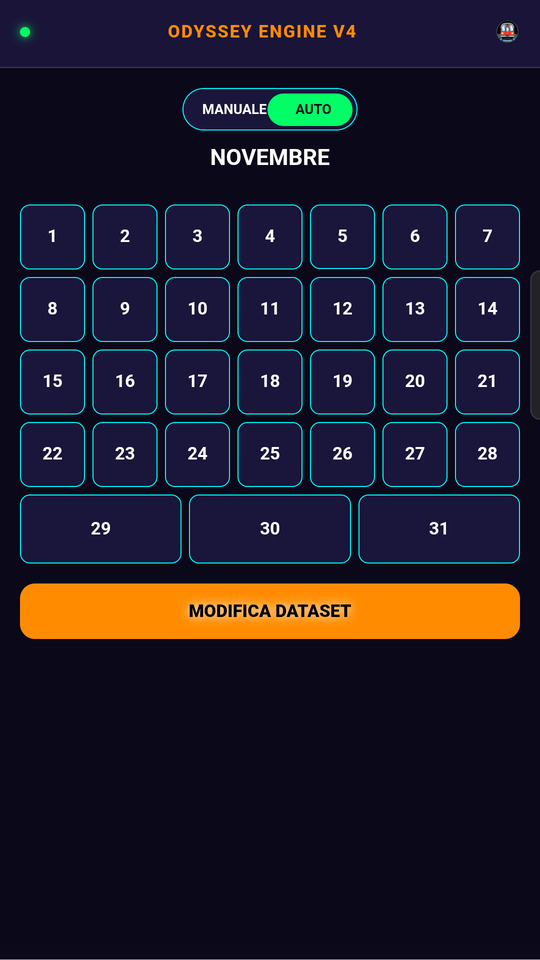
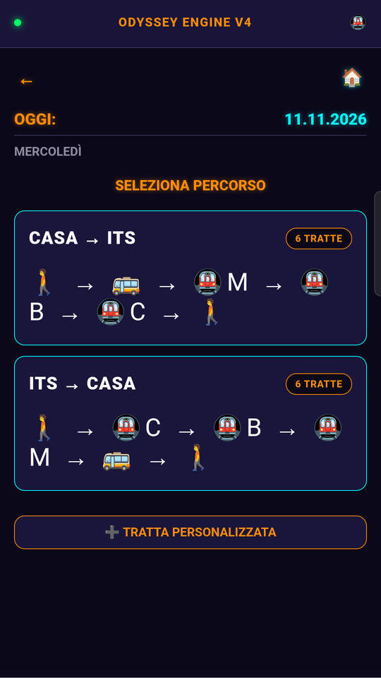
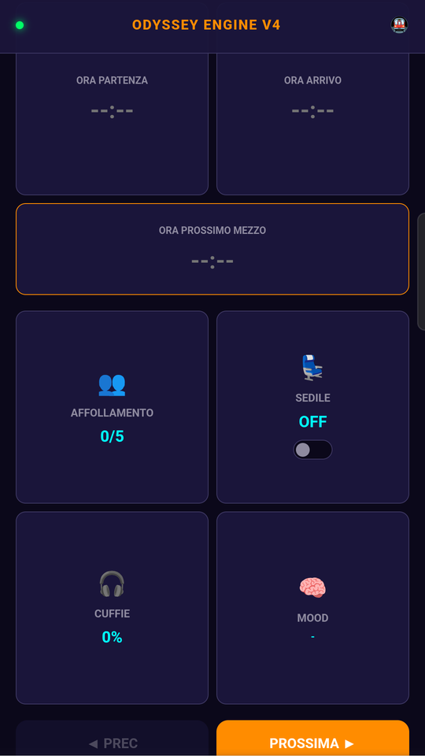

# Odyssey · Diario del pendolare

Progetto personale. È nato da un esercizio di "meditazione sui dati" proposto all'ITS: osservare per un mese un'abitudine quotidiana e trasformarla in dati. Io ho scelto i miei spostamenti coi mezzi pubblici.

## Cosa fa
Una web app in Google Apps Script collegata a un foglio Google:
- **inserimento rapido** dei viaggi giorno per giorno, con i viaggi frequenti già mappati e le singole tratte;
- **calcolo automatico** delle colonne derivate nel foglio;
- grafica scura "neon", pensata per l'uso da telefono.

| Calendario del mese | Scelta del percorso | Dati di una tratta |
|---|---|---|
|  |  |  |

## Struttura
- `app/*.gs`: backend (servizi sul foglio, calcoli, configurazione)
- `app/*.html`: interfaccia (HTML, CSS, JS)
- `README_originale.md`: le specifiche che avevo scritto all'inizio

L'app è stata sviluppata con l'assistenza di LLM; specifiche, scelte e prove sul campo sono mie. I dati raccolti restano privati e non sono in questa cartella.

Tecnologie: Google Apps Script (JavaScript), HTML/CSS, Google Fogli.
